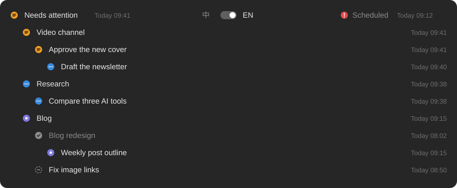
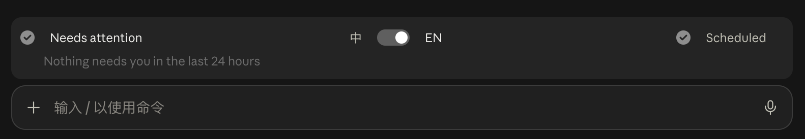

**English** | [简体中文](README.zh-CN.md)

# Task Band for Claude Code

**Task Band is a free, open-source mod for the Claude desktop app (Code tab) that adds a one-line status band above the prompt, showing which scheduled tasks and Claude Code sessions are running, waiting for your reply, or finished while you were away. One click opens the session.**

If you run many Claude Code sessions and scheduled tasks, the sidebar folds them away and it is easy to forget which ones need you. Task Band answers one question at a glance: *what needs my attention right now?*



Collapsed, it is a single line above the prompt. When nothing needs you:



## Features

- **Needs attention (left):** regular sessions from the last 24 hours that are running, waiting for your reply, ready for review, or finished and not opened yet, grouped by your sidebar groups.
- **Scheduled (right):** runs of your scheduled tasks from the last 24 hours that are not handled yet, grouped by task and named after the task.
- **Done disappears:** anything you have opened and that has nothing new goes away. The session you are looking at is never listed.
- **Sub-sessions stay nested:** a session started from another one sits under its parent, like in the sidebar.
- **One click opens the session.** Collapsed, it is a single line; click either side to expand.
- **English and Chinese**, switched with the toggle in the middle. The choice is saved and survives an app restart.
- **Light on resources:** one session does the reading and writes a small shared result; every other session only checks that file. No network calls, no tokens.

## What the icons mean

| Icon | State | When |
| --- | --- | --- |
|  | Running | The session is working right now |
|  | Needs you | A scheduled run stopped and waits for you (expired login, rate limit, a decision) |
|  | Ready for review | Finished and asks for your review or reply |
|  | Not opened yet | Finished after you last looked at it |
|  | Stopped midway | Ended without finishing its turn |
|  | Done | Nothing left for you |

## Requirements

- The **Claude desktop app on macOS**, Code tab (Task Band reads the desktop app's own session records).
- A Claude Code version with function-hook mods (2.1.299 or later).

## Install

In a terminal session of Claude Code:

```
/plugin install task-band --marketplace genoooool/claude-task-band
```

From a shell:

```
claude plugin install task-band --marketplace genoooool/claude-task-band
```

In the desktop app, where `/plugin` does not run: click **+** next to the prompt box, then **Plugins**, **Add marketplace** with `genoooool/claude-task-band`, then **Add plugin**.

Open a new session and the band appears above the prompt.

## How it works

- Task Band reads the session records the Claude desktop app keeps in `~/Library/Application Support/Claude/claude-code-sessions/`, the sidebar groups in `claude_desktop_config.json`, and the scheduled task names from the app's scheduled-tasks service.
- A session counts as **read** when you open it in the app or click it in the band after its last activity, which matches the sidebar's unread dot.
- One open session is "on duty": every 5 seconds it re-reads only the records that changed and writes `~/.claude/task-band/board.json` when the result changes. Every other session watches that small file. If the session on duty closes, another takes over within 90 seconds.
- Times are shown on your computer's clock, in your timezone.

## Privacy

Everything stays on your computer. Task Band reads local files and writes to `~/.claude/task-band/`. It makes no network requests and does not use the model, so it costs no tokens.

## FAQ

### How do I see which Claude Code sessions need my attention?

Install Task Band and open a session in the Claude desktop app. The left side of the band, **Needs attention**, lists every session from the last 24 hours that is running, waiting for your reply, or finished unread, grouped by project.

### How do I check the status of Claude Code scheduled tasks?

The right side of the band, **Scheduled**, lists the runs of your scheduled tasks from the last 24 hours that are not handled yet: running, needing you, ready for review, or not opened. Click a task to see its runs, and a run to open it.

### Why doesn't the band appear on the "New task" page?

That page is not a session yet, so nothing runs there. Send the first message and the band appears within a second or two.

### Does Task Band slow down Claude or use tokens?

No tokens: it never calls the model. Only one session reads the records, re-reading just the files that changed; the others check one small file every 5 seconds. Idle sessions are paused by the app after 15 minutes, and the mod with them.

### Can I switch the language?

Yes. Use the toggle in the middle of the band. Your choice is saved and applies to every session, including after a restart.

### Does it work in the terminal or on the web?

No. It reads records only the Claude desktop app writes, so it is for the desktop app's Code tab on macOS.

## Limitations

- It relies on the desktop app's local file formats, which are not a public API and may change with app updates.
- "Running" is inferred: a session whose last turn has no summary yet and had activity in the last 15 minutes.
- Mods are an early-access feature of Claude Code.

## Development

```
claude plugin validate .
claude plugin test .
```

## License

[MIT](LICENSE)
