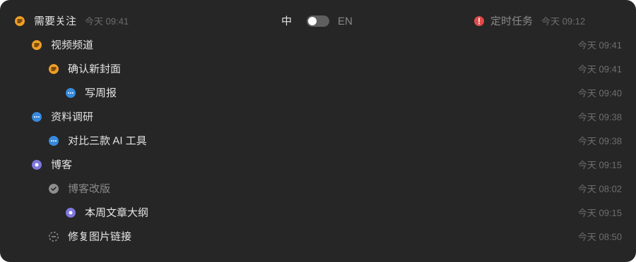
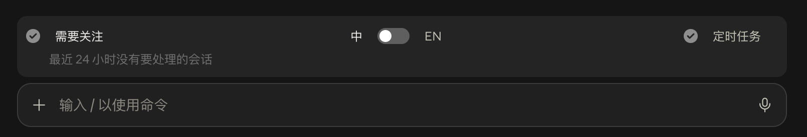

[English](README.md) | **简体中文**

# Task Band：Claude Code 定时任务与会话状态条

**Task Band 是一个免费、开源的 Claude 桌面 app（Code 标签页）插件，在输入框上方加一条状态条：哪些定时任务和 Claude Code 会话正在运行、在等你回复、或者在你离开时已经跑完还没看，一眼就能看到，点一下就打开对应会话。**

会话和定时任务一多，侧边栏会把它们折叠起来，很容易忘了哪个需要你处理。Task Band 只回答一个问题：*现在有什么要我处理？*



收起时只有输入框上方的一行。没有要处理的时候是这样：



## 功能

- **需要关注（左边）**：最近 24 小时内正在运行、等你回复、等你审、或者跑完还没点开的普通会话，按侧边栏分组归类。
- **定时任务（右边）**：最近 24 小时内还没处理完的定时任务运行，按任务归类，显示任务本身的名字。
- **处理完就消失**：你看过、之后没有新动静的会话不再显示；你正在看的那个会话也不显示。
- **子会话有层级**：从别的会话里开出来的子会话，排在上级下面，和侧边栏一样。
- **点一下就打开会话**。收起时只有一行，点左右任意一边展开。
- **中英两种语言**，用中间的开关切换；选择会保存，重启 app 也记得。
- **很省资源**：只有一个会话负责读取，写出一份很小的共享结果，其他会话只看这个文件。不联网，不花 token。

## 图标含义

| 图标 | 状态 | 什么时候 |
| --- | --- | --- |
|  | 运行中 | 会话正在工作 |
|  | 卡住 | 定时任务停下来等你处理（登录失效、限流、等你拍板） |
|  | 等你审 | 跑完了，等你审核或回复 |
|  | 没点开过 | 在你最后一次看它之后又跑完了 |
|  | 中途停了 | 这一轮没跑完就停了 |
|  | 已完成 | 没有要你处理的 |

## 使用条件

- **macOS 上的 Claude 桌面 app**，Code 标签页（插件读的是桌面 app 自己存的会话记录）。
- 支持函数钩子插件的 Claude Code 版本（2.1.299 或更新）。

## 安装

在 Claude Code 的终端会话里输入：

```
/plugin install task-band --marketplace genoooool/claude-task-band
```

或者在命令行里：

```
claude plugin install task-band --marketplace genoooool/claude-task-band
```

在桌面 app 里（不能用 `/plugin` 时）：点输入框旁边的 **+**，选 **插件**，**添加插件市场**，填 `genoooool/claude-task-band`，再 **添加插件**。

新开一个会话，输入框上方就会出现状态条。

## 工作原理

- 读取 Claude 桌面 app 存在 `~/Library/Application Support/Claude/claude-code-sessions/` 里的会话记录、`claude_desktop_config.json` 里的侧边栏分组，以及 app 定时任务服务里的任务名。
- 在最后一次动静之后，你在 app 里打开过、或在状态条里点开过，就算**看过**，和侧边栏的未读蓝点一致。
- 开着的会话里有一个"值班"：每 5 秒只重新读有变化的记录，结果变了才写 `~/.claude/task-band/board.json`；其他会话只看这个小文件。值班的会话关掉后，90 秒内会有别的会话接手。
- 时间按你电脑的时区显示。

## 隐私

所有数据都留在你的电脑上。插件只读本地文件，只往 `~/.claude/task-band/` 里写；不联网，不调用模型，不花 token。

## 常见问题

### 怎么看哪些 Claude Code 会话需要我处理？

装好 Task Band，在 Claude 桌面 app 里打开一个会话。状态条左边的**需要关注**，会按项目列出最近 24 小时内正在运行、等你回复、或者跑完没看的会话。

### 怎么查看 Claude Code 定时任务的运行状态？

状态条右边的**定时任务**，列出最近 24 小时内还没处理完的定时任务运行：运行中、卡住、等你审、没点开过。点任务看它的每次运行，点某次运行就打开对应会话。

### 为什么"新建任务"页面上不显示状态条？

那个页面还不是一个会话，后台还没有启动。发出第一条消息后，一两秒内就会出现。

### 会拖慢 Claude 或者花 token 吗？

不花 token，它从不调用模型。只有一个会话负责读取，而且只重新读有变化的文件；其他会话每 5 秒看一眼一个小文件。闲置 15 分钟的会话会被 app 暂停，插件也跟着停。

### 能切换语言吗？

可以，用状态条中间的开关。选择会保存，所有会话都跟着变，重启也记得。

### 终端版或网页版能用吗？

不能。它读的是只有 Claude 桌面 app 才会写的记录，所以只适用于 macOS 上桌面 app 的 Code 标签页。

## 限制

- 依赖桌面 app 的本地文件格式，这不是公开接口，app 更新后可能需要跟着调整。
- "运行中"是推算的：最后一轮还没有总结、且 15 分钟内有动静的会话。
- 插件（mod）是 Claude Code 的早期测试功能。

## 开发

```
claude plugin validate .
claude plugin test .
```

## 许可证

[MIT](LICENSE)
